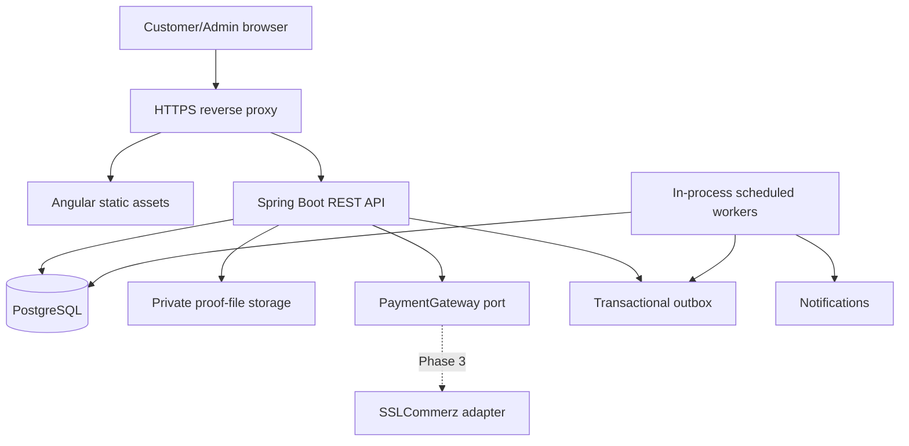

# Baked & Browned — Architecture
Version: 1.1 | Status: Implementation baseline | Time zone: Asia/Dhaka

> v1.1 incorporates approved decisions ADR-0007 … ADR-0015 (`docs/adr/`).

## Goals and scope
Online-first bakery in Dhaka. Initial products: brownie boxes, cookies, pastries and customizable cakes. Support public catalog, authenticated checkout, custom options, kitchen capacity, scheduled delivery to configured Dhaka zones, COD and manual (bank/MFS) payments, online payments, and admin operations.

## Technology
- Backend: **Java 25** (ADR-0007), Spring Boot 4.x, Maven, Spring Web MVC, Spring Data JPA, Spring Security, OAuth2 Resource Server, Flyway, PostgreSQL 17+.
- Frontend: Angular 22 standalone components, strict TypeScript, Tailwind CSS 4, Signals, RxJS, Reactive Forms.
- Operations: Docker Compose, reverse proxy with TLS, GitHub Actions, structured logging, health checks, backups.
- Confirm exact compatible dependency versions during project bootstrap (Phase 1, slice 1A) and record them in the README.

## Deployment architecture

One modular monolith initially. No Kafka, Redis or Kubernetes in MVP. Single API instance in MVP (in-process schedulers and rate limits assume this; workers still use `FOR UPDATE SKIP LOCKED` so a second instance would be safe).

## Backend package boundaries
`com.bakedandbrowned.{identity,catalog,customization,delivery,inventory,scheduling,ordering,payment,notification,reporting,audit}` with controller/service/repository/dto/entity subpackages. `delivery` owns delivery zones; `scheduling` owns slots. `common` contains security, exception mapping, configuration, clock and shared value objects (`Money`, `PhoneNumber`). Controllers do not expose JPA entities; customer and admin DTOs are distinct where their fields differ (ADR-0014). Cross-module calls occur through service interfaces, not direct repository access.

## Frontend organization
`core/` auth, HTTP interceptors, configuration, layout; `shared/` reusable UI and types; `features/` catalog, product-detail, customizer, cart, checkout, orders, account, admin. Use lazy routes, typed API clients generated from OpenAPI, Signals for local state, RxJS for asynchronous HTTP. Money values are displayed from server responses only and never recomputed for submission.

## Identity and security
- CUSTOMER and ADMIN roles. Public registration always assigns CUSTOMER.
- ADMIN accounts are provisioned out of band by an operator-run one-off command that reads credentials from the environment at run time and refuses to run if an ADMIN already exists. No credentials in migrations, seed data or source control.
- Passwords hashed with Argon2id; server enforces 12–128 characters.
- JWT access tokens: 15 minutes, signed asymmetrically (key id in header, key from secret store); validate issuer, audience, expiry, signature and authorities.
- Rotating opaque refresh tokens: store SHA-256 hash; Secure HttpOnly `SameSite=Strict` cookie scoped to `/api/v1/auth`. Each rotation records `replaced_by_id`/`used_at`; presenting a used token revokes the whole `family_id`. Refresh, logout and reuse revocation serialize on a per-family advisory lock (ADR-0025).
- Session lifetime (ADR-0025): a family ends `family_expires_at` after login (CUSTOMER 30 d, ADMIN 12 h); each token expires after the role's idle lifetime (CUSTOMER 14 d, ADMIN 8 h) but never after `family_expires_at`. The cookies' `Max-Age` is the token's remaining lifetime.
- CSRF: double-submit. Login/refresh set a readable `XSRF-TOKEN` cookie; `/auth/refresh` and `/auth/logout` require the `X-CSRF-Token` header to match, plus an `Origin` allow-list check. Bearer-authenticated endpoints do not use cookies and are not CSRF-sensitive.
- Default deny: only the public endpoints listed in the contract are `permitAll`; `/admin/**` requires ADMIN at URL and method level. Object ownership checked in services; non-owned orders return 404.
- Admin MFA is required before production launch (Phase 5).
- Rate-limit login, registration, refresh, checkout, manual-payment submission (in-process limiter for the single MVP instance; reverse-proxy limits as a second layer). Never log credentials, tokens, proof files or full payment payloads.

## Core checkout consistency
1. Authenticate user and validate request and idempotency key. If `(user_id, idempotency_key)` exists: same `request_hash` → return existing order; different → 422.
2. Validate product status, options, effective selection limits and text; validate delivery zone eligibility (active, fee configured, minimum order).
3. Reprice on server (zone fee from DB), determine required ingredients and production capacity, check lead times, compute `cancellation_deadline`.
4. In one short PostgreSQL transaction: lock delivery slot and ingredient rows in deterministic order (slot, then ingredients by id) via guarded `UPDATE … RETURNING`, reserve capacity and ingredients, create order + immutable snapshots, create the PENDING payment record, write initial `order_status_history`, set `expires_at = commit time + 15 min` for ONLINE/MANUAL, write outbox event.
5. Commit; for ONLINE the client then calls `initiate`, which calls the gateway outside any transaction.
6. Verify payment server-to-server; in a new transaction lock the order row, re-check state, and confirm or release reservations.
7. Scheduled workers handle hold expiry, delayed callbacks, reconciliation and outbox delivery.

Use a unique `(user_id, idempotency_key)` constraint. Handle concurrent duplicate requests by catching the unique violation and recovering the existing committed order in a new transaction. Never call external services while holding database locks.

## Order state machine
| From | To | Trigger / actor | Side effects |
|---|---|---|---|
| — | CONFIRMED | COD placement (customer) | slot+inventory reservations CONFIRMED |
| — | PENDING_PAYMENT | ONLINE/MANUAL placement (customer) | reservations HELD, 15-min hold |
| PENDING_PAYMENT | CONFIRMED | verified gateway success (GATEWAY), manual verification (ADMIN, payments endpoint only), or ADMIN reinstating a payment held for review (HIGH_RISK case) | reservations CONFIRMED |
| PENDING_PAYMENT | EXPIRED | expiry job (SYSTEM) | release holds once |
| PENDING_PAYMENT | CANCELLED | customer (before deadline), ADMIN (reason), manual rejection (ADMIN) | release holds once |
| CONFIRMED | CANCELLED | customer (before deadline) or ADMIN (reason) | release once; refund request if paid |
| CONFIRMED | PREPARING | ADMIN | consume ingredients once |
| PREPARING / READY | CANCELLED | ADMIN (reason) | release slot; consumed stock not returned; refund request if paid |
| PREPARING → READY → OUT_FOR_DELIVERY → DELIVERED | | ADMIN | — |
| EXPIRED | CONFIRMED | ADMIN resolving a LATE_SUCCESS reconciliation case, only if fresh reservations succeed | new reservations |

The generic `PATCH /admin/orders/{id}/status` cannot move an order out of PENDING_PAYMENT to CONFIRMED or out of EXPIRED; those go through the payment and reconciliation endpoints. Payment status is independent of fulfillment status. COD may be CONFIRMED with PENDING payment. Every transition writes `order_status_history` and admin transitions also write `audit_events`.

## Payments (ADR-0011, ADR-0012)
- `PaymentGateway` port (payment module), provider-agnostic: `createSession(order, payment) → {sessionId, checkoutUrl}`, `verify(providerEvent) → VerifiedPaymentResult`, `queryStatus(sessionId) → VerifiedPaymentResult`. Adapters translate provider callbacks (JSON or form-encoded) into the port's types; verification always includes a server-to-server status/validation call where the provider offers one.
- Phase 1: port + `FakePaymentGateway` (test/dev profiles only). Phase 3: SSLCommerz adapter after merchant onboarding and confirmation of current API requirements.
- Manual payments: customer submission (provider, reference, optional proof) → ADMIN verification or rejection → audit. Proof files are stored outside the web root in private storage (local volume in MVP behind a `ProofStorage` interface), validated by magic bytes, max 5 MB, JPEG/PNG/PDF, served only to ADMIN with `Content-Disposition: attachment` and `X-Content-Type-Options: nosniff`.
- Refunds are a separate workflow (REQUESTED → APPROVED/REJECTED → COMPLETED), audited, and approved by a second ADMIN, never the requester (ADR-0017). Full or partial; together never more than the payment.

## Scheduled workers
- Hold expiry: every minute, claim overdue PENDING_PAYMENT orders with `FOR UPDATE SKIP LOCKED`, re-check, expire, release once.
- Reconciliation (`ReconciliationJob`): every minute, claim ONLINE payments still PENDING or CANCELLED between 2 minutes and 48 hours old (one guarded UPDATE each), query the gateway outside any transaction and apply the answer like a callback; checks back off to a quarter of the payment's age. A payment that ages out while its last check failed becomes an AMBIGUOUS_STATUS case.
- Outbox dispatcher: claim due events with `SKIP LOCKED`, deliver, exponential backoff via `next_attempt_at`, alert on backlog.

## Pricing and time
- BDT only for MVP; Java BigDecimal, PostgreSQL NUMERIC(12,2); JSON money serialized with exactly 2 decimals.
- Client prices are display-only; backend calculates subtotal, option deltas, zone delivery fee and discount (always 0 in MVP).
- Store instants as TIMESTAMPTZ (UTC); interpret delivery dates, "today" and reports in Asia/Dhaka via a single injected `Clock`.
- Delivery slots represent bounded kitchen/courier capacity units, not merely order counts.
- Lead times and cancellation cutoffs vary by product. Availability, eligibility and cutoff validation run at order creation.

## Observability
Structured JSON logs, trace IDs (returned in problem+json `traceId`), Spring Actuator health/readiness, alerts on 5xx, failed payments, expiring holds, open reconciliation cases, low stock, and outbox backlog. Administrative changes and payment decisions go to `audit_events`. Keep PII out of logs.

## Deployment
Build frontend static assets and backend container; run PostgreSQL on a private network or managed service. Reverse proxy `/api` to backend. Secrets via environment/secret manager. Run Flyway migrations on deployment. Backup PostgreSQL and proof storage daily with tested restore and defined retention. Pin container image versions; use non-root users and health checks.

## Delivery roadmap
| Phase | Scope |
|---|---|
| 1 Foundation & identity | Repo/CI, migrations V1–V5, common web layer, security & auth, `PaymentGateway` port + fake, outbox/scheduler skeleton, Angular shell + generated client + auth UI |
| 2 Core commerce (COD + manual) | Catalog & admin catalog, customization (brownie boxes), delivery zones, slots, inventory & recipes, quote, checkout, order detail, cancellation, hold expiry, manual payment verification, admin order operations, refunds workflow, notifications, dashboard |
| 3 Online payments | SSLCommerz adapter, webhook verification, reconciliation worker & cases |
| 4 Custom cakes | Cake option groups, disallowed combinations, option ingredients |
| 5 Production hardening | Security test pass, MFA, alerting, backup/restore drill, load test on checkout |

## Testing gates
- Unit: pricing, option validation (effective selection rule), transitions, lead time, cancellation deadline (strictest cutoff), zone eligibility.
- Integration (Testcontainers PostgreSQL): DB constraints, locking, idempotency (same/different body), simultaneous last-stock and last-slot checkouts, reservation expiry (including concurrent expiry runs and expiry vs confirmation race), cancellation cutoffs, manual payment verification/rejection, zone eligibility, one-time consumption/release, audit/history rows.
- API: authorization/ownership, invalid inputs, problem+json errors, contract conformance against `api-contract.yaml`.
- UI: dynamic forms, cart, checkout, admin workflows.
- E2E: COD order; manual payment; gateway success/failure/duplicate webhook/late payment (Phase 3).
- Security: CSRF refresh, refresh-token reuse, XSS in cake messages, IDOR, rate limits, proof-file upload validation.

## Architecture decisions
ADR-001 modular monolith; ADR-002 PostgreSQL as source of truth; ADR-003 outbox for reliable side effects; ADR-004 server-owned pricing; ADR-005 hosted payment page; ADR-006 no external calls inside transactions. ADR-0007 onward are recorded in `docs/adr/`.

## Explicit future extensions
Ingredient lots/expiry and wastage ledger; production jobs separate from delivery slots; promotions; guest checkout; product images/object storage; notification templates; customer address book; password reset.
